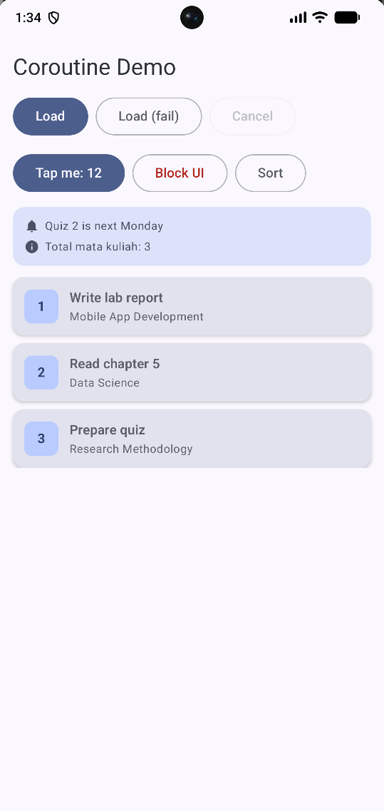
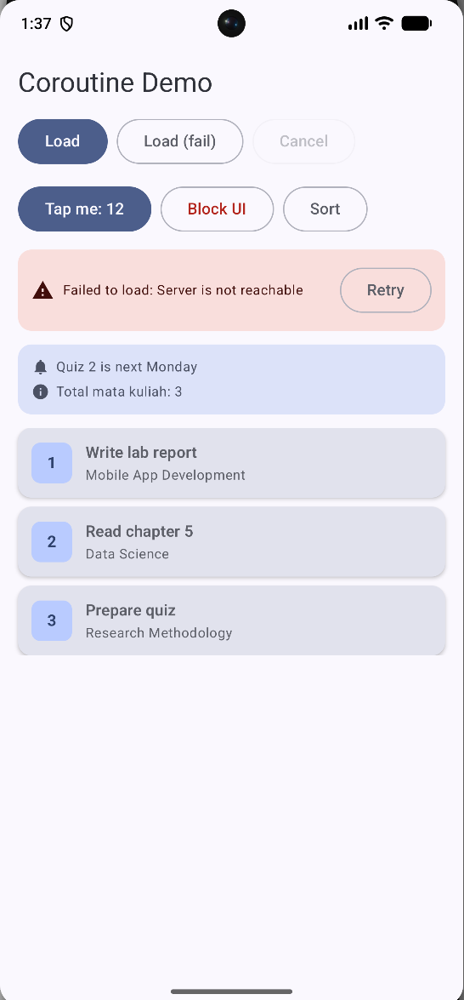
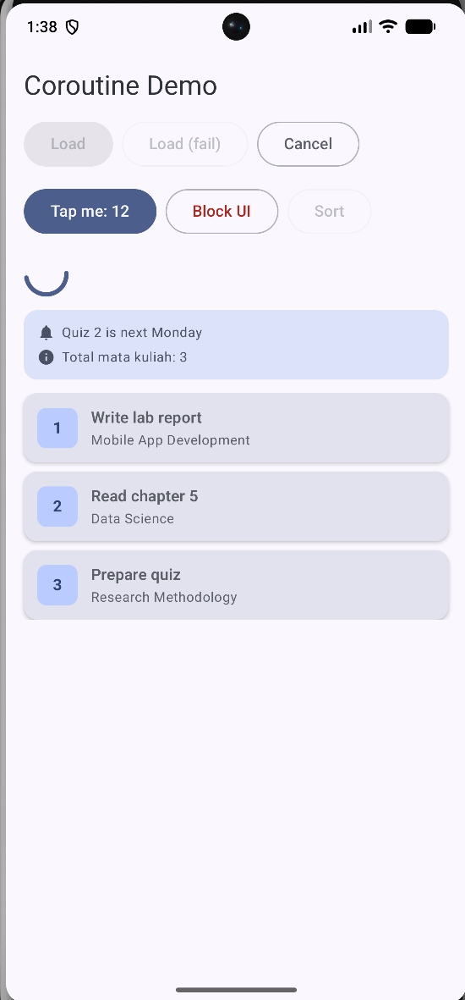

# Coroutine Demo

Aplikasi Android sederhana untuk mendemonstrasikan penggunaan Kotlin Coroutines
dan Asynchronous Programming pada mata kuliah Pengembangan Aplikasi Bergerak.

## Deskripsi

Aplikasi ini dibuat berdasarkan modul M17 - Kotlin Coroutines and Asynchronous
Programming. Aplikasi menampilkan daftar tugas dan pengumuman yang dimuat secara
asinkron menggunakan Kotlin Coroutines dengan pola arsitektur MVVM.

## Fitur

| Tombol | Fungsi | Konsep |
|---|---|---|
| Load | Memuat tasks dan announcement secara bersamaan (~2 detik) | launch, async, withContext |
| Load (fail) | Simulasi server gagal, menampilkan pesan error | try/catch, structured concurrency |
| Cancel | Menghentikan proses loading yang sedang berjalan | Job.cancel() |
| Tap me | Menghitung berapa kali ditekan, membuktikan UI tetap responsif | Suspend tidak menghambat thread |
| Block UI | Membekukan layar selama 3 detik | Contoh buruk Thread.sleep() |
| Sort | Mengurutkan daftar task A–Z | Dispatchers.Default, withContext |

## Latihan 9

### Latihan 1 — Tambah permintaan async ketiga
Ditambahkan `getCourseCount()` di `TaskRepository` dengan `delay(1500L)`.
Hasilnya disimpan di field `courseCount` pada `TasksUiState` dan dimuat
dengan async ketiga di `loadData()`.

Total waktu pemuatan tetap ~2 detik karena ketiga async berjalan **bersamaan
(concurrent)**, bukan satu per satu. Waktu total ditentukan oleh pekerjaan
terlama yaitu `getTasks()` selama 2 detik.

### Latihan 2 — Tombol Retry
Tombol Retry ditampilkan di dalam Card error. Tombol hanya muncul
saat `errorMessage` tidak null, dan memanggil `loadData()` kembali saat ditekan.

### Latihan 3 — Menangkap terlalu banyak
Jika `catch (e: IOException)` diganti menjadi `catch (e: Exception)`,
saat tombol Cancel ditekan akan muncul pesan **"Failed to load: null"**
alih-alih **"Loading cancelled"**.

Hal ini terjadi karena `CancellationException` ikut tertangkap oleh
`catch (e: Exception)`. Padahal `CancellationException` adalah mekanisme
pembatalan coroutine yang seharusnya tidak ditangkap. Akibatnya coroutine
yang dibatalkan dianggap gagal, bukan dibatalkan.

### Latihan 4 — Di mana macetnya?
- Mengganti `delay(2000L)` dengan `Thread.sleep(2000L)` di dalam
  `withContext(Dispatchers.IO)` → layar **tidak macet**, karena
  `Thread.sleep` berjalan di thread IO, bukan main thread.
- Menghapus `withContext` lalu menggunakan `Thread.sleep(2000L)` langsung →
  layar **macet**, karena `Thread.sleep` berjalan di main thread dan
  memblokir seluruh UI selama 2 detik.

### Latihan 5 — Pertanyaan konsep

**(a) Beda `launch` dan `async`**

`launch` dipakai untuk menjalankan coroutine tanpa nilai balik, hasilnya
berupa `Job`. `async` dipakai saat membutuhkan nilai balik, hasilnya berupa
`Deferred<T>` dan nilainya diambil dengan `await()`.

**(b) Kenapa `GlobalScope` sebaiknya dihindari**

`GlobalScope` hidupnya sama dengan aplikasi dan tidak terikat lifecycle
apapun. Coroutine di dalamnya terus berjalan meskipun layar sudah ditutup,
sehingga berpotensi menyebabkan kebocoran memori dan pekerjaan sia-sia.

**(c) Apa yang terjadi pada `getAnnouncement()` kalau `getTasks()` gagal**

Karena keduanya berada dalam `coroutineScope`, saat `getTasks()` melempar
`IOException`, scope langsung membatalkan semua child termasuk
`getAnnouncement()`. Fungsi tersebut tidak pernah mengembalikan nilai dan
exception diteruskan ke blok `try/catch` di luar `coroutineScope`.

### Latihan 6 — Tombol Sort
Ditambahkan tombol Sort yang mengurutkan daftar task berdasarkan judul A–Z.
Proses pengurutan dijalankan di `Dispatchers.Default` menggunakan `withContext`,
lalu hasilnya diperbarui ke state.

## Modifikasi Tampilan

Modifikasi dilakukan hanya pada `TasksScreen.kt`:

| Bagian | Modul | Modifikasi |
|---|---|---|
| Tombol Block UI | Warna default | Warna merah untuk memperjelas ini contoh buruk |
| Error message | `Text` biasa | `Card` dengan background `errorContainer` + ikon Warning |
| Tombol Retry | Tombol terpisah di bawah teks | Masuk dalam Card yang sama dengan pesan error |
| Announcement | `Text` biasa | `Surface` berwarna + ikon Notifications |
| Course count | `Text` biasa | Dalam Surface yang sama dengan ikon Info |
| Card task | `Column` biasa | `Row` dengan kotak nomor task berwarna di kiri |

## Screenshot

| State Awal | Error | Loading | Sort |
|---|---|---|---|
|  |  |  |  |

## Arsitektur

```
TasksScreen (UI)
     ↓ event
TasksViewModel (viewModelScope, StateFlow)
     ↓ panggil
TaskRepository (suspend fun + withContext)
```

## Struktur Proyek

```
com.example.coroutinedemo
├── data
│   ├── Task.kt
│   └── TaskRepository.kt
├── ui
│   └── main
│       ├── TasksUiState.kt
│       ├── TasksViewModel.kt
│       └── TasksScreen.kt
└── MainActivity.kt
```

## Teknologi

- Kotlin Coroutines (`kotlinx.coroutines`)
- Jetpack Compose
- ViewModel + StateFlow
- Lifecycle (`viewModelScope`, `collectAsStateWithLifecycle`)
